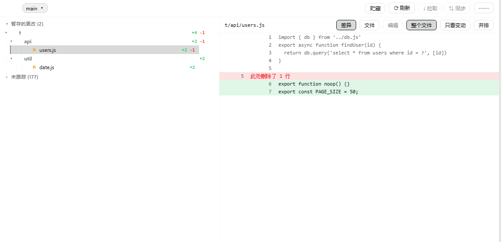
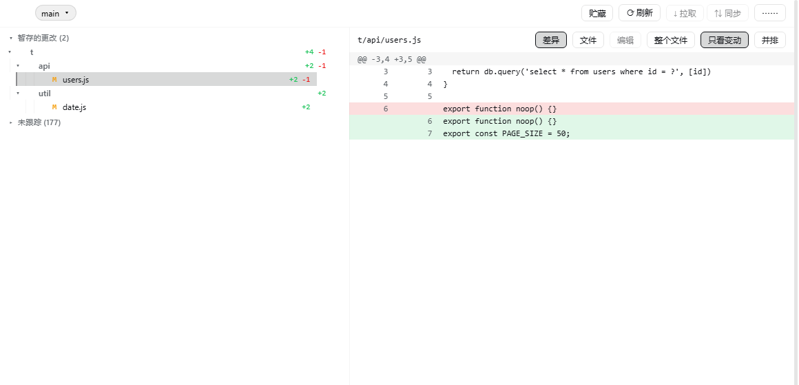
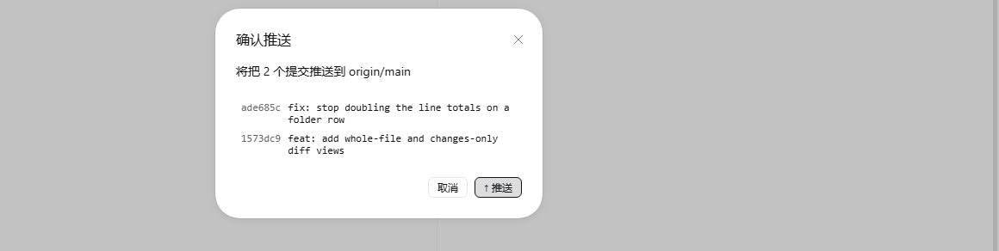
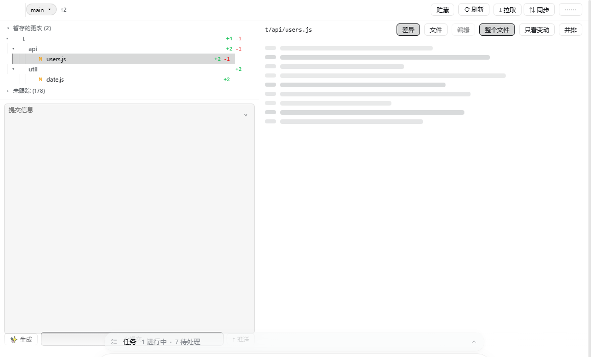

# Git View

Review, stage, commit and push the session repository's git changes from the
Harness conversation view.

[中文](README.zh.md)



## What it does

A **Git** tab in the conversation view ring, after Trajectory. It reads the
repository the session is working in — no path to configure, no second UI.

- **Change groups** — conflicts, staged, unstaged and untracked, each with
  folder rows that fold a whole subtree and stage or discard it in one action.
- **Three ways to read a file** — whole file with the changes marked, changes
  only as a unified diff, or side by side. Remembered across sessions.
- **Edit and save** — open a working-tree file in the panel and write it back,
  guarded by the version the read returned.
- **Branches, stash, pull, sync** — and a fetch, refresh and discard group.
- **Commit and push** — an AI-written commit message from the staged diff, a
  commit button that commits, and a push button that lists every commit it would
  publish before it publishes them.



Untracked directories stay folded until opened, and opening one asks git about
that directory alone. A working tree with twenty thousand untracked files costs
the same to list as one with twenty.

## Install

Requires dsh 0.2.0-rc.2 or newer, Node 22.19+ or 24+, and a session whose
working directory is a git repository.

```sh
dsh plugin --profile <profile> add shinchen6/dsh-git-view
```

Then restart the profile and open the **Git** tab in a conversation.

## Screenshots

The push button lists what it would publish first.



The commit box enlarges from its top-right control.



## License

[Apache-2.0](LICENSE)
